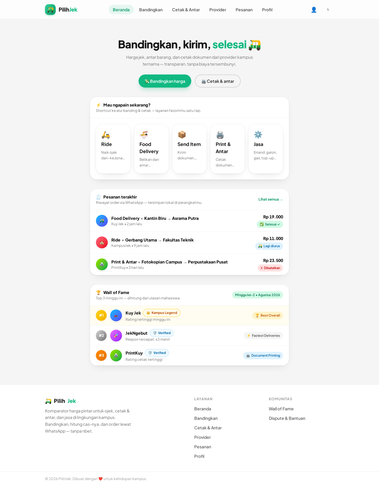
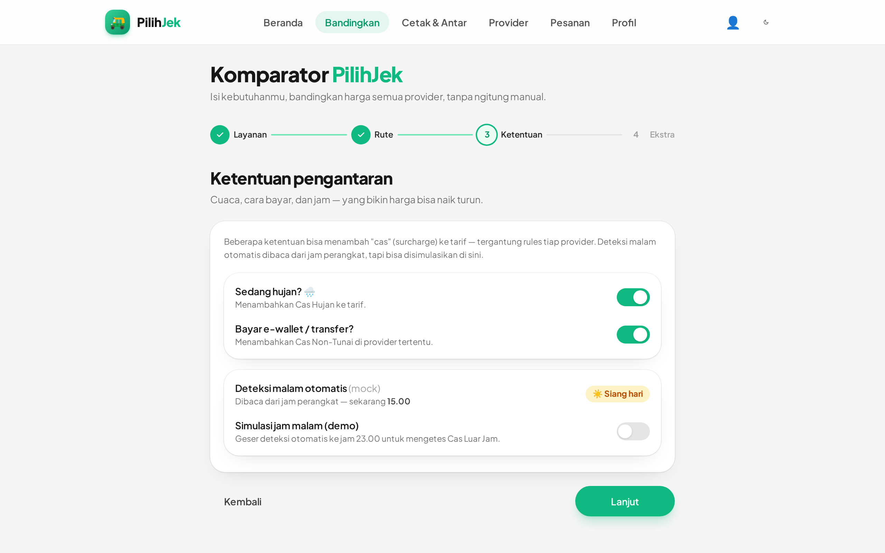
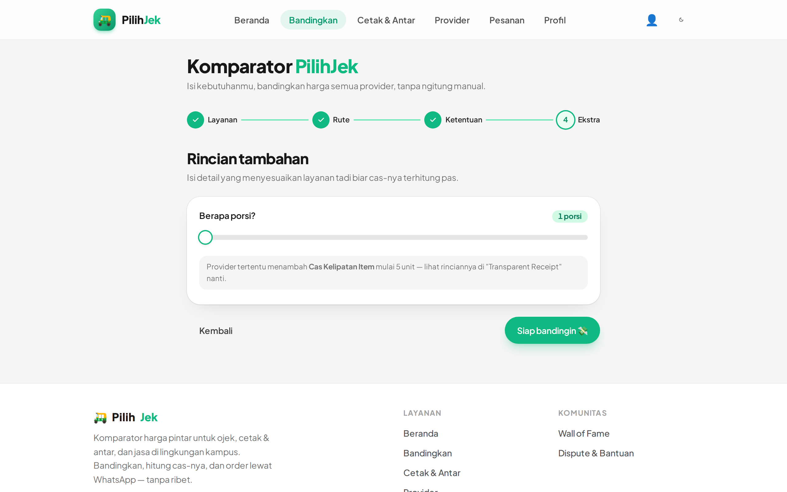
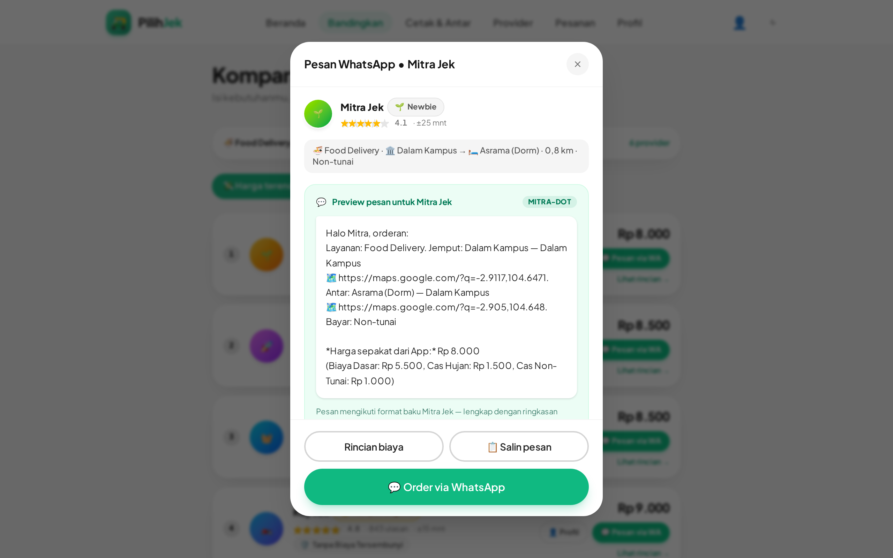
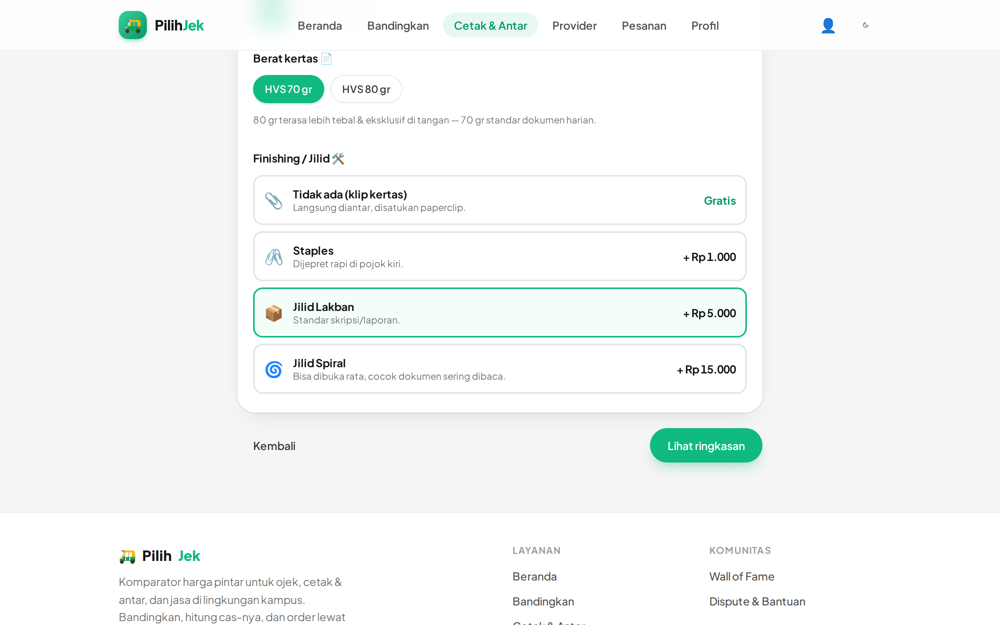
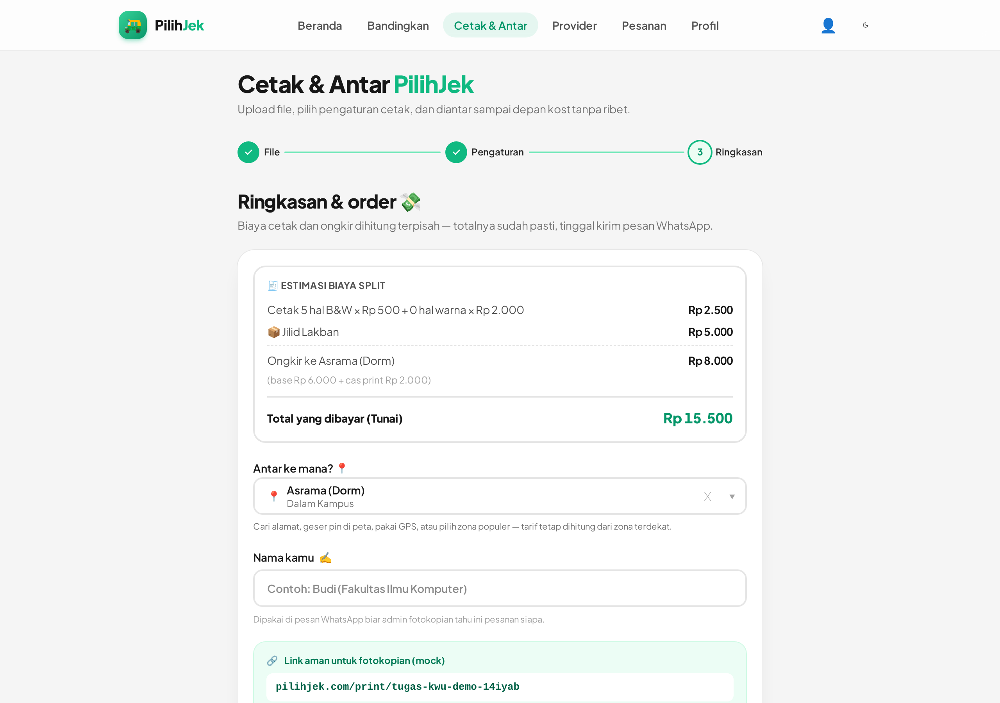
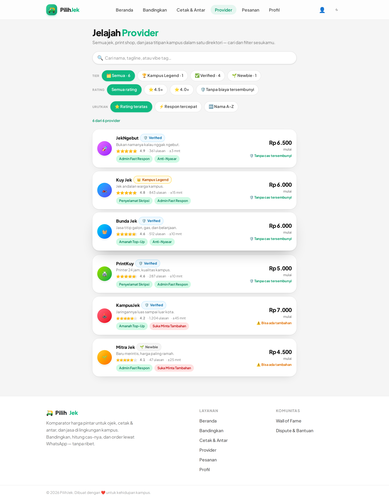
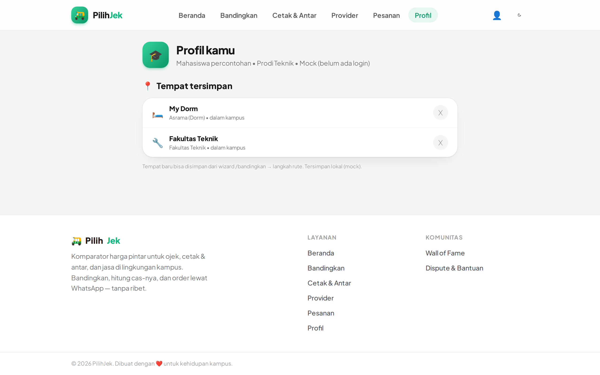
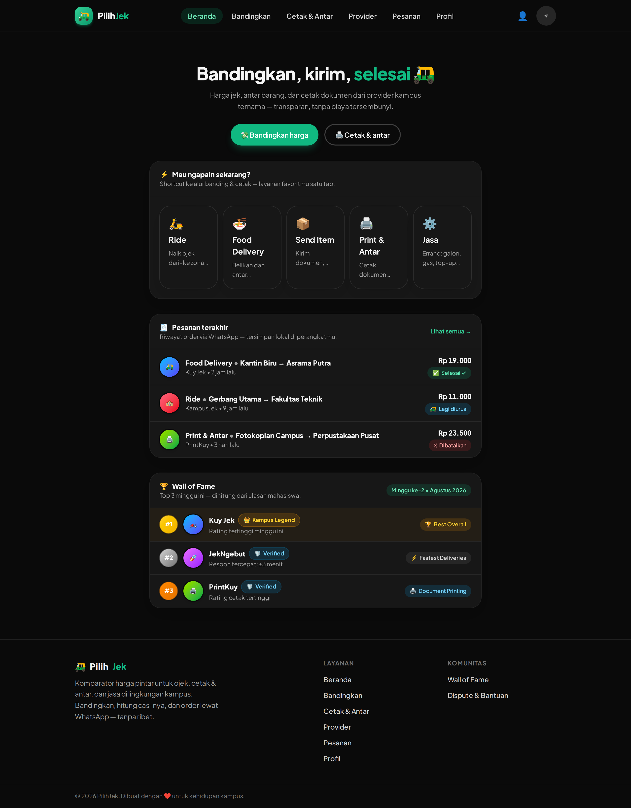

# PilihJek 🛺 — Bandingkan Harga Ojek & Jasa Kampus dalam Sekali Klik

> **"Bandingkan, kirim, selesai."**

Capek buka banyak story Instagram cuma buat ngecek ongkir ojek kampus? Takut kena biaya tambahan mendadak pas hujan atau salah format chat WhatsApp?

**PilihJek** adalah aplikasi web gratis untuk **mahasiswa di sekitar kampus** (khususnya area Indralaya, UNSRI) yang membantu kamu:

- 💰 **Bandingkan harga total** dari berbagai jasa ojek & antar lokal sekaligus — langsung terlihat mana yang paling murah.
- 🧾 **Tahu semua biaya tambahan ("cas") di awal** — hujan, malam, non-tunai, sampai kelipatan porsi, semua dihitung otomatis tanpa tebak-tebakan.
- 💬 **Order via WhatsApp tanpa salah format** — pesan sudah disusun otomatis sesuai aturan masing-masing jasa, tinggal klik kirim.

Gratis, **nyaman dibuka di HP**, tanpa perlu bikin akun, dan mendukung **mode gelap** 🌙.

---

## Daftar Isi

- [Kenapa PilihJek?](#kenapa-pilihjek)
- [Fitur Utama](#fitur-utama)
- [Cara Pakai](#cara-pakai)
- [Contoh Hitungan Nyata](#contoh-hitungan-nyata)
- [Pertanyaan yang Sering Ditanyakan (FAQ)](#pertanyaan-yang-sering-ditanyakan-faq)
- [Catatan Versi Uji Coba](#catatan-versi-uji-coba)

---

## Kenapa PilihJek?

Jasa ojek dan antar lokal di sekitar kampus (seperti **Kuy Jek** dan sejenisnya) biasanya beroperasi lewat WhatsApp dengan daftar harga berupa gambar yang tersebar di Instagram. Akibatnya:

- **Harga asli baru ketahuan belakangan** setelah admin membalas chat.
- **Banyak biaya tambahan ("cas") yang bikin kaget** — mulai dari cas hujan, jam malam, bayar non-tunai, banyak porsi, mampir ke toko lain, sampai top-up.
- **Format chat tiap jasa beda-beda dan kaku** — salah urutan format saja bisa bikin pesan harus diulang atau bahkan kena **denda 50%**.
- **Susah tahu mana jasa yang amanah** — tidak ada gambaran apakah adminnya fast respon atau sering menghilang (*ghosting*).

Lihat contoh daftar harga asli jasa lokal kampus (dengan berbagai aturan cas)

**PilihJek bukan layanan ojek baru.** Kami mengumpulkan daftar harga dari jasa-jasa lokal yang sudah ada, menghitungkan total biayanya secara transparan, lalu menyiapkan pesan WhatsApp yang rapi agar kamu bisa langsung order.

| Sebelum pakai PilihJek | Pakai PilihJek |
|---|---|
| Buka 3–5 akun IG, cocokkan tarif, lalu nebak sendiri biaya tambahannya | Pilih layanan, rute, dan kondisi → **semua jasa langsung terhitung & terurut dari yang termurah** |
| Ketik pesan WA manual, deg-degan salah format kena denda 50% | Pesan **otomatis disusun sesuai format masing-masing jasa**, tinggal kirim |
| Tebak-tebakan jasa ini fast respon atau sering telat | Cek **rating, ulasan, dan label karakter jasa** sebelum order |

---

## Fitur Utama

### 1. Bandingkan Semua Jasa Sekaligus 💰

Cukup isi 4 langkah singkat: **Layanan → Rute → Kondisi → Detail Tambahan**. Pilihan yang muncul akan menyesuaikan kebutuhanmu, jadi tidak ribet.

- Pilih **zona populer**, cari alamat, geser pin di peta, atau pakai **GPS** — tarif tetap dihitung rapi berdasarkan zona terdekat.
- Hasil langsung diurutkan dari yang **termurah**, lengkap dengan estimasi waktu respon admin, rating, dan label (*Termurah*, *Respon Tercepat*, *Tanpa Biaya Tersembunyi*).

| Pilih Layanan | Pilih Rute Jemput & Antar |
|---|---|
|  |  |

| Kondisi (Hujan, Non-Tunai, Malam) | Detail Tambahan (Porsi/Item) |
|---|---|
|  |  |

---

### 2. Rincian Biaya Transparan 🧾

Ketuk harga mana saja untuk melihat **rincian biaya lengkapnya**: tarif dasar ditambah setiap biaya tambahan (hujan, non-tunai, malam, kelipatan porsi, dll.).

Rincian ini **ikut tertulis di pesan WhatsApp**, jadi kamu dan admin sudah sepakat soal harga sejak awal — tidak ada biaya dadakan.

---

### 3. Pesan WhatsApp Otomatis Sesuai Format 💬

Setiap jasa punya aturan format chat sendiri (ada yang pakai tanda `-`, ada yang pakai `|`, ada yang wajib mencantumkan nama). PilihJek otomatis menyusun pesan sesuai format jasa yang kamu pilih, lengkap dengan **link Google Maps** lokasi jemput/antar dan ringkasan harga.

Cukup tekan **"Order via WhatsApp"**, chat langsung terbuka dengan pesan yang sudah siap kirim.

---

### 4. Cetak & Antar Dokumen 🖨️

Butuh nge-print tugas atau skripsi tanpa keluar kost? Gunakan fitur **Cetak & Antar**:

- **Upload file PDF** — jumlah halaman langsung terhitung otomatis agar estimasi biaya akurat.
- Pilih **warna** (hitam putih, full warna, atau campuran), **ukuran kertas** (A4/F4/A3), dan **jilid** (staples, lakban, spiral).
- Rincian biaya **cetak, jilid, ongkir, dan cas tunggu** ditampilkan terpisah lalu dijumlahkan dengan jelas.
- File tidak perlu dikirim lewat chat WA — kamu mendapat **link aman sekali pakai** yang bisa langsung dibuka pihak fotokopian.

| Upload PDF | Pengaturan Cetak | Ringkasan Biaya |
|---|---|---|
|  |  |  |

---

### 5. Kenali Jasa Sebelum Order 🏆

Sebelum memilih, kamu bisa melihat profil tiap jasa di halaman **Provider**:

- **Rating per aspek**: kecepatan, keamanan barang, dan kejujuran tarif.
- **Label khas mahasiswa**: mulai dari yang positif (*Penyelamat Skripsi*, *Admin Fast Respon*, *Anti-Nyasar*) sampai peringatan (*Suka Minta Tambahan*, *Admin Jutek*).
- **Wall of Fame** mingguan untuk melihat jasa paling dipercaya di kampus.
- **Tombol lapor masalah**: kalau admin *ghosting* atau driver tidak datang, kamu bisa langsung lapor dari halaman pesanan — skor jasa akan disesuaikan dan PilihJek langsung merekomendasikan alternatif lain.

| Direktori Jasa | Profil & Ulasan |
|---|---|
|  |  |

---

### 6. Riwayat Pesanan & Lokasi Tersimpan 📍

Semua pesanan tercatat rapi di halaman **Pesanan**, dan lokasi yang sering kamu pakai (seperti kost, asrama, atau fakultas) bisa **disimpan di Profil** supaya order berikutnya makin cepat.

| Riwayat Pesanan | Profil & Lokasi Tersimpan |
|---|---|
|  |  |

---

### 7. Nyaman di HP & Mendukung Mode Gelap 📱🌙

Dirancang agar enak dipakai langsung dari layar HP dengan satu tangan, lengkap dengan **mode gelap** yang bisa mengikuti pengaturan perangkatmu.

| Tampilan HP | Mode Gelap |
|---|---|
|  |  |

---

## Cara Pakai

### Bandingkan Harga & Order
1. Buka **Bandingkan** (atau pilih langsung ikon layanan di Beranda).
2. Pilih layanan yang kamu butuhkan: **Ride 🛵**, **Food Delivery 🍜**, **Send Item 📦**, **Print & Antar 🖨️**, atau **Jasa ⚙️** (galon, gas, top-up, belanja).
3. Tentukan **lokasi jemput & antar** lewat zona populer, pencarian, peta, atau GPS.
4. Aktifkan **kondisi** yang sedang terjadi (hujan 🌧️, bayar non-tunai; jam malam terdeteksi otomatis).
5. Isi **detail tambahan** jika ada (jumlah porsi, jumlah toko mampir, atau nominal top-up).
6. Tekan **"Siap bandingin"**, pilih jasa yang paling cocok, cek rincian biayanya, lalu klik **"Order via WhatsApp"**.

### Cetak & Antar Dokumen
1. Buka menu **Cetak & Antar**, lalu unggah file **PDF** kamu.
2. Pilih pengaturan warna, jenis kertas, dan jilid.
3. Tentukan lokasi pengantaran, cek total biayanya, lalu klik **"Order via WhatsApp"** — link file otomatis ikut terkirim.

---

## Contoh Hitungan Nyata

**Skenario:** Pesan **Food Delivery** dari **Dalam Kampus → Asrama (Dorm)**, sedang **hujan**, bayar **non-tunai**, sebanyak **6 porsi**.

| Komponen Biaya | Kuy Jek | KampusJek |
|---|---:|---:|
| Tarif dasar (Dalam Kampus → Asrama) | Rp 6.000 | Rp 7.000 |
| Cas Hujan | + Rp 1.000 | Rp 0 |
| Cas Non-Tunai | + Rp 1.000 | + Rp 2.000 |
| Cas Kelipatan Item (6 porsi) | + Rp 1.000 | + Rp 2.000 |
| **Total** | **Rp 9.000** ✅ *Termurah* | **Rp 11.000** |

### Biaya Tambahan ("Cas") yang Dihitung Otomatis

| Jenis Cas | Kapan Berlaku |
|---|---|
| **Cas Hujan** | Saat pemesanan dilakukan ketika hujan |
| **Cas Non-Tunai** | Saat pembayaran dilakukan via transfer atau e-wallet |
| **Cas Luar Jam (Malam)** | Saat order di luar jam operasional normal (misalnya ≥ 22.00) |
| **Cas Kelipatan Item** | Saat memesan makanan/barang dalam jumlah banyak |
| **Cas Mampir** | Saat belanja atau ambil barang di lebih dari satu tempat |
| **Cas Top-Up** | Berdasarkan nominal top-up e-wallet |
| **Cas Print** | Biaya tunggu driver di tempat fotokopi untuk layanan Cetak & Antar |

> Besaran setiap cas mengikuti aturan masing-masing jasa — ada yang tidak mengenakan cas hujan, ada pula yang lebih hemat di malam hari. Semua langsung terlihat di hasil perbandingan.

---

## Pertanyaan yang Sering Ditanyakan (FAQ)

**Apakah PilihJek itu layanan ojek sendiri?**
Bukan. PilihJek menghubungkan kamu dengan jasa ojek dan antar lokal yang sudah ada di sekitar kampus (seperti Kuy Jek, JekNgebut, KampusJek, PrintKuy, Bunda Jek, Mitra Jek, dan lainnya). Pemesanan tetap berlangsung langsung lewat WhatsApp jasa pilihanmu.

**Apakah harga di PilihJek pasti sama dengan yang dibayar?**
PilihJek menghitung berdasarkan daftar harga tiap jasa, dan **rincian biayanya ikut dikirim ke WhatsApp admin** agar transparan sejak awal. Meski begitu, tarif tetap mengikuti kebijakan masing-masing jasa jika sewaktu-waktu ada pembaruan. Jika terjadi selisih yang tidak wajar, kamu bisa melaporkannya dan memberi ulasan untuk membantu mahasiswa lain.

**Apakah saya harus membuat akun? Bagaimana dengan keamanan data saya?**
Tidak perlu login atau daftar akun. Riwayat pesanan dan lokasi tersimpan hanya disimpan **di perangkatmu sendiri**. Untuk layanan cetak dokumen, file tidak dikirim lewat chat WhatsApp, melainkan melalui link aman sekali pakai.

**Kenapa cetak dokumen harus dalam format PDF?**
Supaya tata letak, font, dan margin dokumenmu tidak berantakan saat dibuka di komputer fotokopian (masalah yang sering terjadi pada file Word atau PowerPoint).

**Apakah PilihJek bisa dipakai di luar area kampus?**
Saat ini zona yang didukung mencakup area kampus dan sekitarnya (seperti Pasar Pagi, Griya Sejahtera, Kost Mutiara Indah, Alun-Alun, dll.). Jika lokasimu berada di luar jangkauan zona, aplikasi akan memberi tahu agar tidak terjadi salah hitung tarif.

**Bagaimana kalau admin tidak membalas (*ghosting*) atau driver tidak datang?**
Kamu bisa melaporkannya langsung dari halaman **Pesanan** lewat tombol **"Admin Ghosted Me"** atau **"Driver Never Arrived"**. Laporanmu akan membantu menurunkan skor keandalan jasa tersebut dan PilihJek akan langsung menyarankan jasa alternatif.

---

## Catatan Versi Uji Coba

Saat ini PilihJek masih berada dalam **tahap uji coba (preview)**, sehingga sebagian daftar harga, ulasan, dan profil jasa yang tampil masih menggunakan data simulasi agar kamu bisa mencoba seluruh alur pemesanan. Ke depannya, kami berencana menggandeng langsung jasa-jasa lokal kampus agar daftar harga selalu terbaru dan akurat setiap saat.

---

*Dibuat dengan ❤️ untuk memudahkan kehidupan kampus — 2026.*
