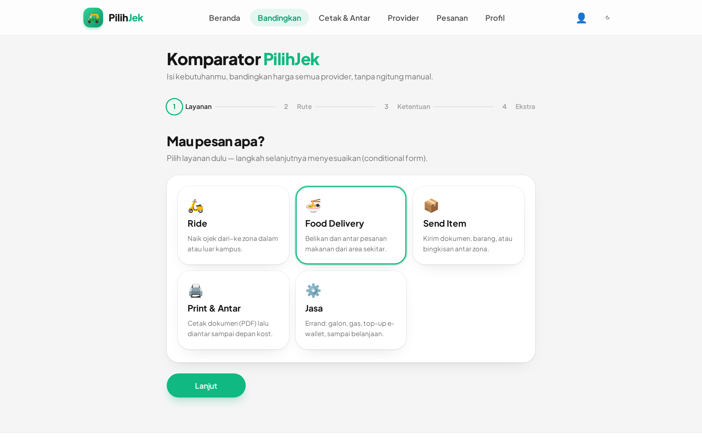
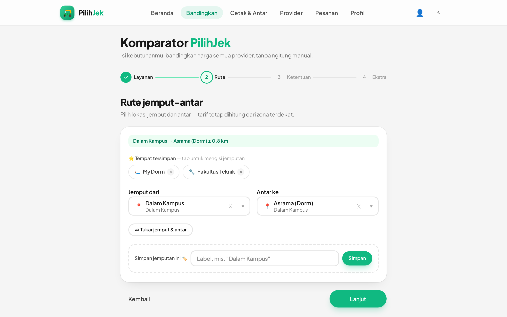
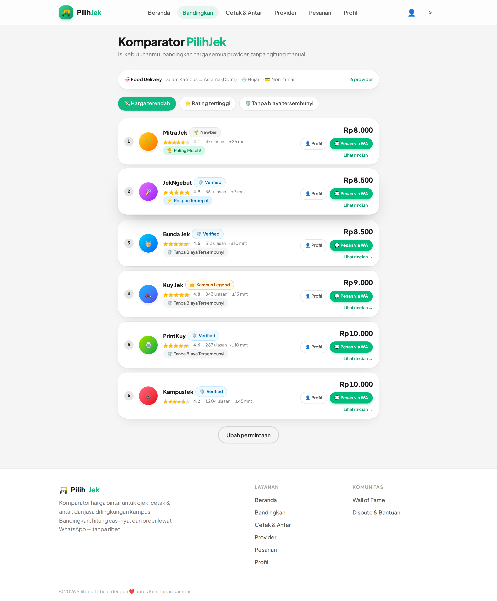
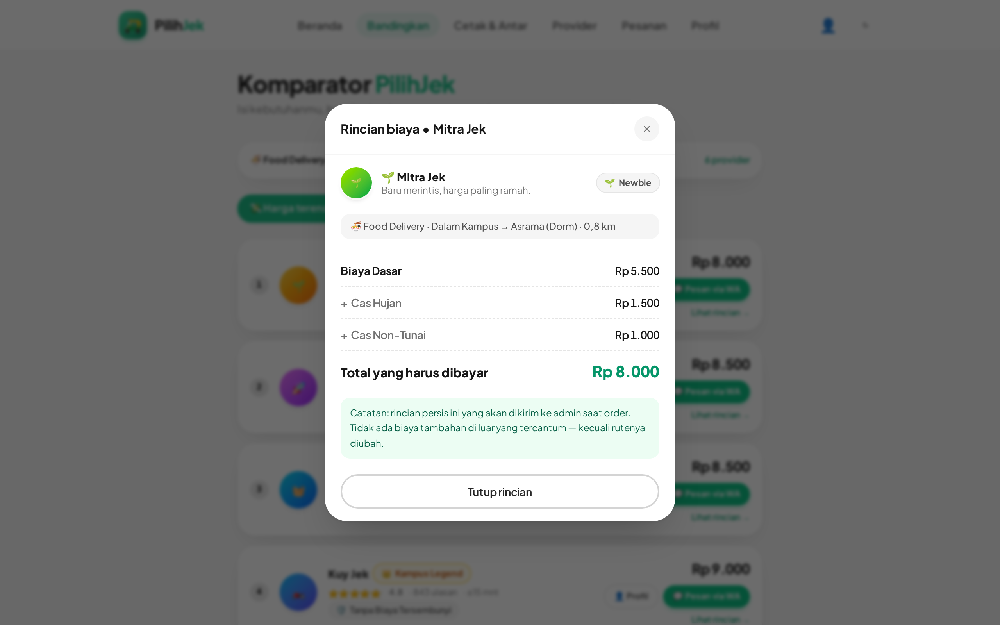
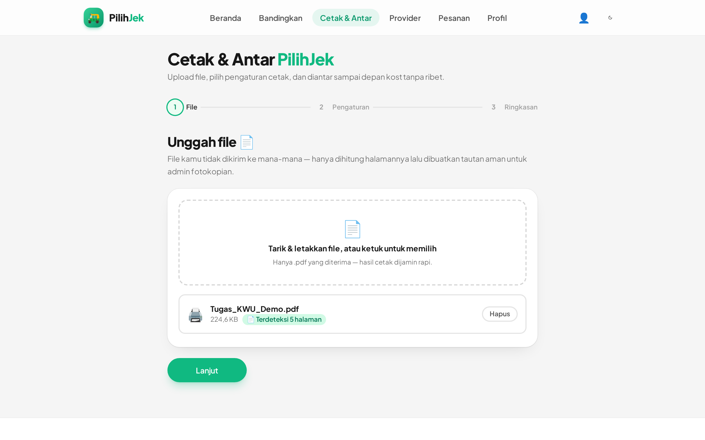
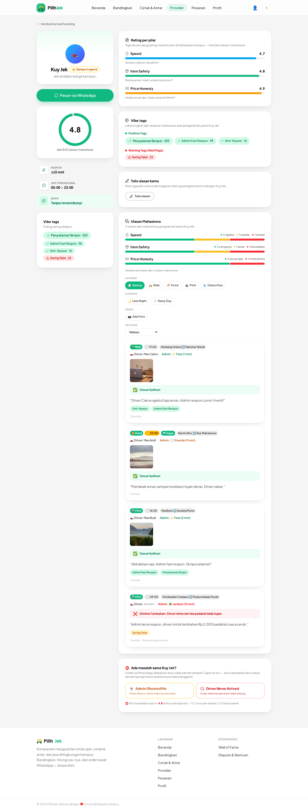
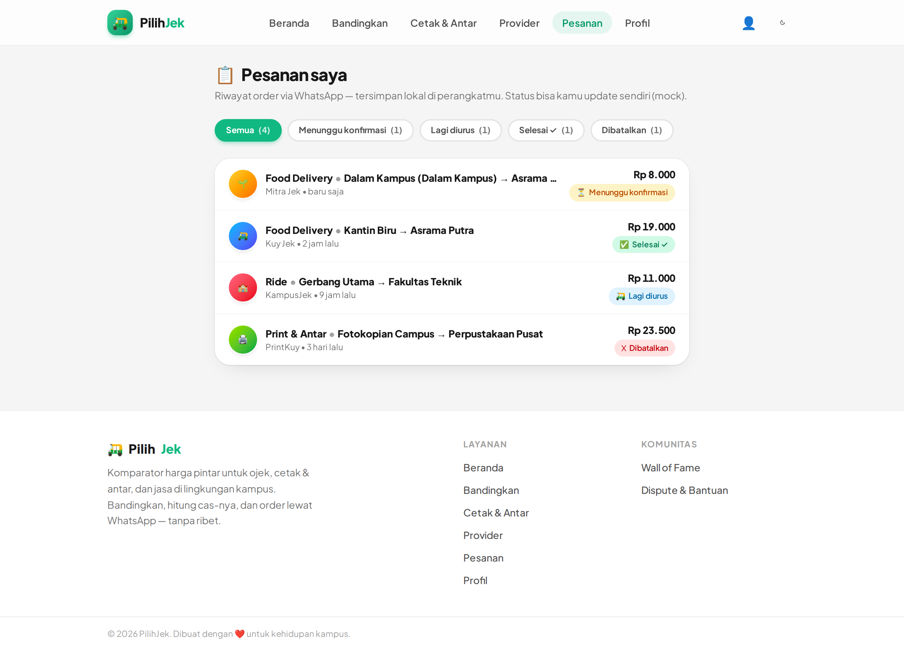
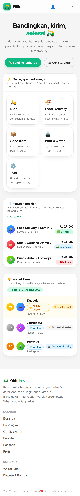

# PilihJek 🛺 — Komparator Harga Ojek & Jasa Kampus

> **"Bandingkan, kirim, selesai."**

PilihJek adalah aplikasi web untuk **mahasiswa di sekitar kampus** (dibuat dengan fokus kampus Indralaya, UNSRI) yang ingin:

- membandingkan **harga total** beberapa provider ojek/antar lokal dalam sekali lihat,
- tahu persis **biaya tambahan ("cas")** apa saja yang membuat tarif naik,
- dan **order lewat WhatsApp tanpa salah format** — karena pesannya dibuatkan otomatis.

Gratis, **mobile-first** (enak dibuka di HP), dan ada **mode gelap** 🌙.


---

## Masalahnya apa sih?

Jasa ojek/antar lokal kampus (mis. **Kuy Jek** dan sejenisnya) jalan lewat WhatsApp dengan **price list gambar yang tersebar di Instagram**. Akibatnya:

- sebelum order, kamu **nggak tahu total harga pastinya** — baru ketahuan setelah admin reply;
- banyak **"cas" (biaya tambahan) tersembunyi**: hujan, malam, non-tunai, banyak item, mampir, top-up…;
- tiap provider punya **format pesan WhatsApp yang kaku** — salah format bisa kena **cas format kebalik 50%** atau pesan harus dikirim ulang;
- kadang **admin ghosting** atau driver telat, dan kamu nggak punya gambaran provider itu aman atau tidak.

Ini contoh price list asli salah satu provider lokal — perhatikan kolom "CAS (Tambahan Ongkir)"-nya:


---

## Jadi, apa itu PilihJek?

PilihJek **bukan layanan ojek baru** — kami tidak merekrut driver. PilihJek adalah **aggregator / komparator**: price list dari provider lokal yang sudah ada kami gabungkan jadi satu tabel perbandingan yang **transparan dan otomatis dihitung**, lalu pesan WhatsApp-nya kami susun sesuai format tiap provider.

| Sebelum pakai PilihJek | Pakai PilihJek |
|---|---|
> Buka 3–5 story IG, cocokkan harga, nebak cas-nya | Pilih layanan + rute + kondisi → **semua provider langsung terhitung dan terurut** |
| Ketik pesan WA manual, takut salah format kena denda 50% | Pesan **dibuat otomatis sesuai format provider**, tombol order aktif setelah data lengkap |
| Bingung provider ini aman atau sering telat | Lihat **rating, vibe tag, dan riwayat masalah** provider sebelum order |

---

## Fitur

### 1. Bandingkan harga semua provider 💰

Alur 4 langkah: **Layanan → Rute → Ketentuan → Ekstra**. Langkah yang muncul menyesuaikan pilihanmu (conditional form), jadi nggak ribet.




Kamu memilih **zona** (bukan ketik alamat panjang) — bisa dari zona populer, cari alamat, geser pin di peta, atau pakai GPS. Tarif tetap dihitung dari zona terdekat, jadi tidak bisa "nyasar".


Hasilnya: daftar provider **terurut dari termurah**, lengkap dengan rating, waktu respon, dan tag (Termurah / Respon Tercepat / Tanpa Biaya Tersembunyi). Kamu bisa urutkan ulang menurut harga atau rating.



### 2. Rincian biaya transparan — "Transparent Receipt" 🧾

Tap harga mana pun untuk melihat **rincian persis**: biaya dasar + setiap cas (hujan, non-tunai, malam, kelipatan item, dst). Rincian ini ikut terkirim di pesan WhatsApp, jadi admin dan kamu sudah sepakat duluan — **tidak ada biaya di luar yang tercantum**.



### 3. Pesan WhatsApp otomatis sesuai format provider 💬

Setiap provider punya format baku yang berbeda (ada yang pakai ` - `, ada yang pakai ` | `, ada yang wajib tulis nama). PilihJek menyusun pesan yang **sudah sesuai format provider itu**, lengkap dengan link Google Maps lokasi jemput/antar dan ringkasan harga. Satu tap **"Order via WhatsApp"** → chat terbuka dengan pesan sudah terisi.


### 4. Cetak & Antar dokumen 🖨️

Alur khusus untuk cetak: **upload PDF → pilih pengaturan cetak → ringkasan & order**.

- File PDF dihitung jumlah halamannya otomatis (biar kamu tahu estimasi harganya).
- Pilih warna (hitam putih / full warna / campuran per halaman), kertas (A4/F4/A3, HVS 70/80 gr), dan jilid (staples, lakban, spiral).
- Biaya **dicetak terpisah dari ongkir**: `cetak + jilid + ongkir + cas print`, semua dijumlah jadi satu total.
- File tidak dikirim lewat WA — kamu dapat **link aman sekali pakai** yang bisa dibuka admin langsung dari komputer fotokopian.




### 5. Kenali provider-nya dulu: rating, vibe tag, Wall of Fame 🏆

Sebelum order, cek direktori provider: rating per pilar (**kecepatan, keamanan barang, kejujuran tarif**), vibe tag ala mahasiswa (*Penyelamat Skripsi*, *Admin Fast Respon*, *Anti-Nyasar*, atau red flag seperti *Suka Minta Tambahan*, *Admin Jutek*), tier kepercayaan (Newbie / Verified / Kampus Legend), dan **Wall of Fame** mingguan.




Kalau sudah order tapi **admin ghosting** atau **driver tidak datang**, lapor lewat tombol di halaman pesanan — laporannya mengurangi skor keandalan provider dan otomatis menyarankan provider alternatif.

### 6. Riwayat pesanan & tempat tersimpan 📍

Semua order via WhatsApp tercatat di halaman **Pesanan** (dengan status: menunggu konfirmasi, lagi diurus, selesai, dibatalkan), dan lokasi yang sering dipakai (kost, fakultas) bisa **disimpan** di **Profil** supaya order berikutnya lebih cepat.




### 7. Ramah HP & mode gelap 📱🌙

Didesain mobile-first: bottom sheet, CTA menempel, navigasi ringkas. Mode gelap aktif otomatis mengikuti setting HP kamu.




---

## Cara pakai

### Bandingkan harga & order

1. Buka halaman **Bandingkan** (atau tap shortcut layanan di beranda).
2. Pilih **layanan**: Ride 🛵 / Food Delivery 🍜 / Send Item 📦 / Print & Antar 🖨️ / Jasa ⚙️ (galon, gas, top-up, belanja).
3. Pilih **lokasi jemput & antar** dari zona populer / cari / peta / GPS.
4. Nyalakan **ketentuan** yang berlaku: sedang hujan 🌧️, bayar e-wallet/transfer, (jam malam terdeteksi otomatis).
5. Isi **ekstra** sesuai layanan: jumlah porsi, jumlah toko tambahan, nominal top-up.
6. Tap **"Siap bandingin"** → pilih provider dari daftar terurut.
7. Cek **rincian biaya**, lalu tap **"Pesan via WA"** → **"Order via WhatsApp"** → pesan terkirim dengan format yang benar.

### Cetak & antar

1. Buka **Cetak & Antar**, upload file **PDF**.
2. Pilih warna, kertas, dan jilid.
3. Pilih lokasi antar, lihat **ringkasan biaya**, lalu **Order via WhatsApp** — link file ikut terkirim.

---

## Contoh perhitungan nyata

Skenario: **Food Delivery, Dalam Kampus → Asrama (Dorm)**, sedang **hujan**, bayar **non-tunai**, beli **6 porsi**.

| Komponen | Kuy Jek | KampusJek (contoh kompetitor) |
|---|---:|---:|
| Biaya dasar (Dalam Kampus → Asrama) | Rp 6.000 | Rp 7.000 |
| Cas Hujan | + Rp 1.000 | Rp 0 |
| Cas Non-Tunai | + Rp 1.000 | + Rp 2.000 |
| Cas Kelipatan Item (6 item) | + Rp 1.000 | + Rp 2.000 |
| **Total** | **Rp 9.000** ✅ termurah | **Rp 11.000** |

Tanpa PilihJek, kamu baru tahu angka ini setelah chat dengan admin dan berisiko salah format.

### "Cas" apa saja yang dihitung otomatis?

| Cas | Kapan muncul |
|---|---|
| Cas Hujan | Saat order bertepatan hujan |
| Cas Non-Tunai | Bayar via transfer / e-wallet |
| Cas Luar Jam (Malam) | Order di luar jam operasional provider (mis. ≥ 22.00) |
| Cas Kelipatan Item | Food delivery dengan banyak porsi/item |
| Cas Mampir | Belanja/jasa di lebih dari satu toko |
| Cas Top-Up | Nominal top-up e-wallet (berjenjang) |
| Cas Print | Order cetak & antar (driver menunggu di fotokopian) |

Besaran tiap cas **mengikuti rules tiap provider** — ada yang tidak kenakan cas hujan, ada yang lebih mahal saat malam. Semua itu langsung tercermin di hasil perbandingan.

---

## FAQ

**Apakah PilihJek layanan ojeknya sendiri?**
Bukan. PilihJek mempertemukanmu dengan provider lokal yang sudah ada (Kuy Jek, JekNgebut, KampusJek, PrintKuy, Bunda Jek, Mitra Jek, dan lainnya). Order-nya tetap lewat WhatsApp provider.

**Apakah harganya dijamin sama dengan yang dibayar?**
PilihJek menghitung dari price list tiap provider dan **rinciannya ikut terkirim di pesan WA**, jadi tidak ada biaya tersembunyi dari sisi aplikasi. Namun harga bisa berubah sewaktu-waktu (S&K provider berlaku) — kalau ada selisih, itu bisa kamu laporkan lewat tombol masalah dan jadi bahan ulasan.

**Apakah data saya aman?**
Aplikasi tidak meminta login. Riwayat pesanan dan tempat tersimpan hanya tersimpan **lokal di perangkatmu** (browser). Untuk cetak & antar, file kamu tidak dikirim via chat — hanya link aman sekali pakai yang dibuat.

**Kenapa harus file PDF untuk cetak?**
Agar hasil cetak rapi dan sama persis seperti yang kamu lihat — dokumen Word/PowerPoint sering berantakan saat dibuka di komputer fotokopian.

**Apakah tersedia di luar area kampus?**
Saat ini zona yang didukung adalah area kampus dan sekitarnya (Pasar Pagi, Griya Sejahtera, Kost Mutiara Indah, Alun-Alun, dst). Lokasi di luar zona terdekat akan diingatkan agar tidak salah hitung tarif.

**Bagaimana kalau provider ghosting / tidak datang?**
Laporkan dari halaman pesanan (**"Admin Ghosted Me"** / **"Driver Never Arrived"**). Laporan mengurangi skor keandalan provider dan aplikasi menyarankan provider berikutnya.

---

## Status proyek

Saat ini PilihJek adalah **prototype frontend fungsional**: seluruh data provider, harga, rating, dan riwayat adalah **data mock** di browser, sehingga semua alur bisa dicoba end-to-end tanpa backend. Rencana ke depan: backend sungguhan (login, notifikasi, upload file ke cloud, dan portal agar provider bisa mengupdate price list-nya sendiri agar harga selalu akurat).

---

## Untuk developer

Kode aplikasi ada di [`app/`](app/) (Vite + React 19 + TypeScript + Tailwind CSS v4 + Leaflet untuk peta). Semua data mock dan titik swap ke backend nyata dijelaskan di [`FRONTEND_PLAN.md`](FRONTEND_PLAN.md) — titik tukarnya cukup satu modul `src/api`.

```bash
cd app
npm install
npm run dev      # jalan di http://localhost:5173
npm run build    # build production ke app/dist
```

Struktur singkat:

```
app/src/
├── api/          # mock data + price engine + ApiClient interface (swap point ke backend)
├── pages/        # Beranda, Bandingkan, Cetak & Antar, Provider, Pesanan, Profil
├── flows/        # wizard komparator, alur cetak, sheet WA, form ulasan
├── components/   # UI kit + peta (Leaflet)
└── hooks/ lib/   # state lokal (localStorage), format IDR, generator pesan WA
```

---

*Dibuat dengan ❤️ untuk kehidupan kampus — 2026.*
